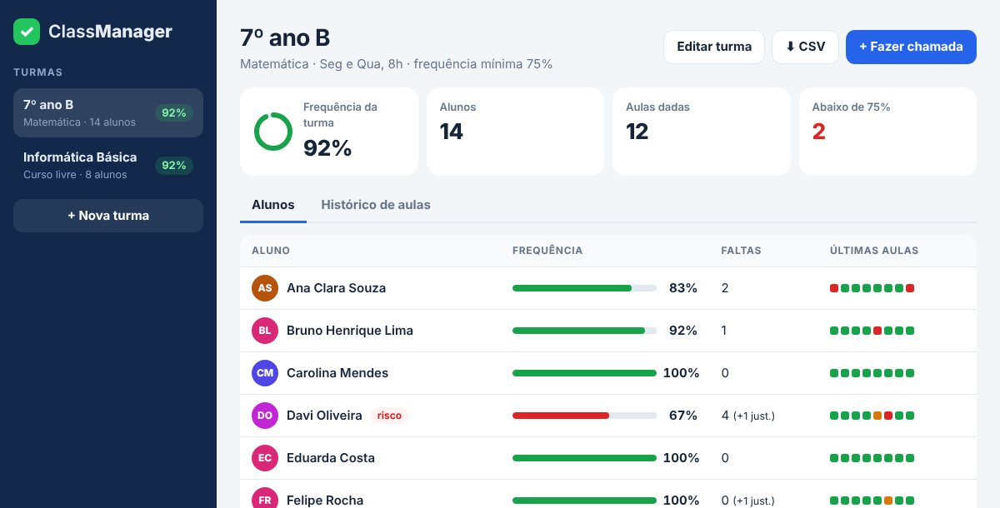

# ClassManager — Turmas e chamada

Gerencie turmas, faça a chamada de cada aula e acompanhe a frequência e o histórico de presença dos alunos.

🔗 **[Ver o site no ar](https://iamviniciuslima05.github.io/PROJETO-ClassManager/)**



## Funcionalidades

- **Turmas** com disciplina, horário e frequência mínima
- **Colar a lista de alunos** de uma vez
- **Chamada** com Presente, Falta e Falta justificada (teclas P, F e J)
- **Frequência** de cada aluno e da turma
- Alerta de alunos **abaixo da frequência mínima**
- **Histórico de aulas** com conteúdo dado
- Histórico de presença **por aluno**
- **Exportar CSV** para abrir no Excel

## Tecnologias

HTML5 · CSS3 · JavaScript · SVG · localStorage

## Estrutura

```
index.html
css/style.css
js/script.js
```

## Como rodar

Não precisa instalar nada: baixe o projeto e abra o `index.html` no navegador, ou acesse a versão publicada acima.

---
Feito por **Vinicius Lima** · [Portfólio](https://viniciuslimadev.netlify.app) · [LinkedIn](https://www.linkedin.com/in/viniciuslima25/)
